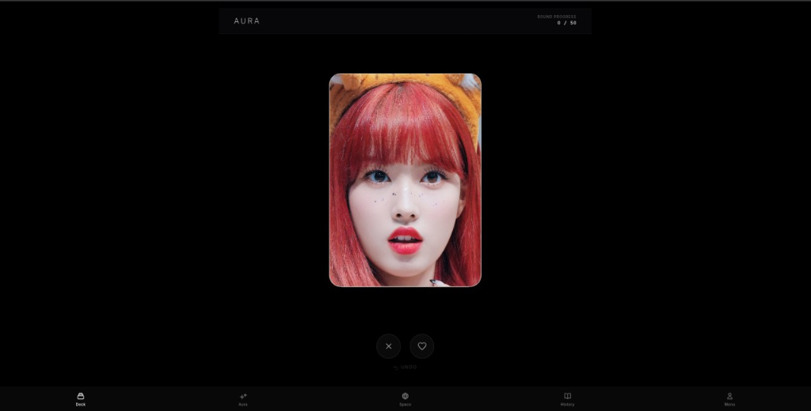
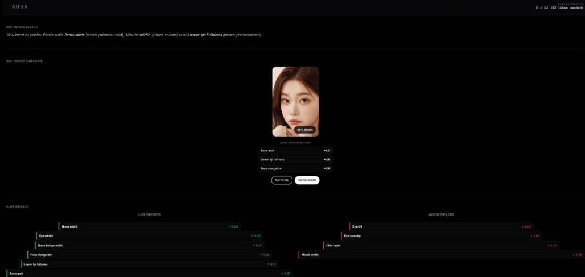
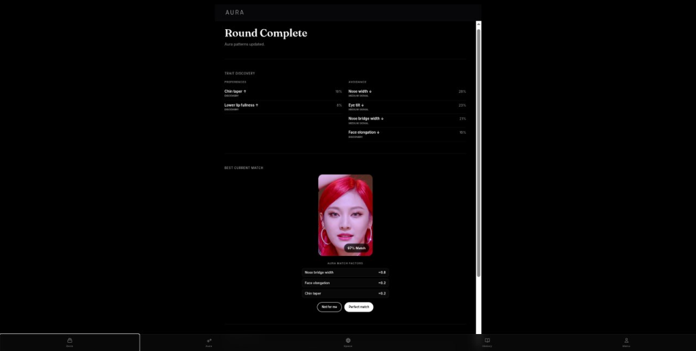

# Aura

A web app that learns facial preference profiles from swipes and pairwise comparisons, builds an evolving preference model, and uses it to personalize subsequent recommendations.

> **Status:** Independently developed engineering project, work in progress. This repository is a **documentation-only showcase**; source code is private. Recommendation quality has **not** been validated through formal user studies or held-out offline evaluations (see [Current Status & Limitations](#current-status--limitations)).

## Overview

Users interact with photo cards through intuitive swipe gestures and comparisons. Aura captures both explicit feedback (likes and dislikes) and behavioral interaction telemetry (decision latency, hesitation, direction reversals, and zoom). It maps these signals onto an evolving preference profile defined across ten facial geometry features.

The preference profile updates asynchronously after every interaction. When generating the next batch of cards, a multi-stage ranking layer scores candidates by combining:
1. An **interpretable long-term feature vector** derived from exponential moving average (EMA) centroids of liked and disliked faces.
2. A **dynamic short-term session vector** that adapts rapidly to within-session mood or taste shifts.
3. A **feature-based Factorization Machine (FM)** that captures non-linear interactions between pairs of facial attributes.
4. An **active-learning exploration layer** powered by an ID-based collaborative Matrix Factorization (MF) model to introduce exploratory recommendations.

A core design goal of Aura is **interpretability**: rather than embedding user tastes into opaque latent vectors, the primary user profile remains anchored to named geometric dimensions. This allows preferences to be rendered back to the user via interactive views (`AuraProfile`, `BehaviorAnalytics`, and `AuraSpaceMap`).

## Interface

The React-based single-page application implements the following primary interfaces:

  
*Main swipe deck: interactive card interface capturing gesture telemetry and interaction timing.*

  
*Preference profile view: interpretable feature affinity bars, detected trait combos, and session behavior analytics.*

  
*Recommendations and round summary: highest-scoring candidate cards, round recap, and best-match reveal.*

Other implemented views include an interactive 2D preference space map (`AuraSpaceMap`), a type archive, a "Guess My Type" mode, and an administrative monitoring dashboard.

## Architecture

Aura separates write-time telemetry ingestion and profile recomputation from read-time candidate ranking:

- **Frontend:** React + Vite single-page application. Collects gesture telemetry client-side and dispatches events to the backend.
- **Backend:** FastAPI with asynchronous SQLAlchemy serving ~28 API endpoints across authentication, telemetry ingestion, recommendations, profiles, analytics, and admin controls.
- **Storage:** PostgreSQL with tables for `users`, `sessions`, `card_actions` (recording per-interaction JSONB telemetry metrics with unique constraints), and `user_preference_snapshots` for caching recomputed profiles. Managed via Alembic migrations.
- **Asynchronous Profile Recompute:** On each swipe, the interaction is synchronously committed to `card_actions` for immediate deduplication. The heavier EMA profile update and Factorization Machine training are offloaded to an asynchronous `BackgroundTask`, caching the resulting profile in PostgreSQL.
- **Dual Factorization Architecture:**
  - **Feature-based Factorization Machine (FM, $k=4$):** An individual-level model trained on the user's personal interaction history to capture non-linear pairings of facial features. Serialized directly into the profile snapshot.
  - **ID-based Matrix Factorization (MF, $k=8$):** A collaborative filtering model trained across multi-user interaction history to support active-learning candidate exploration.
- **Catalog & Normalization:** A 98-card catalog precomputed with 10 geometric features, normalized at backend startup via a median/IQR scaler (`PoolScaler`).
- **Face Profiler:** A decoupled, **offline** computer vision pipeline (MediaPipe + OpenCV) used to extract landmark geometries and build the card catalog. It is not part of the runtime request path.

## Preference Learning & Recommendation

For in-depth mathematical formulations and parameter details, see [docs/preference-engine.md](docs/preference-engine.md).

- **Telemetry Confidence Weighting:** Swipes are dynamically weighted by behavior. Ultra-fast likes (<120 ms) are penalized as accidental swipes ($\times 0.2$), fast decisive dislikes are amplified ($\times 2.0$), and high hesitation or direction reversals penalize event weight. Final confidence is clamped to $[0.05, 2.5]$.
- **Long-Term EMA Profile:** Tracks exponential moving average centroids for liked and disliked cards with adaptive learning rate $\alpha = \min(1.0, 0.10 \times \text{confidence})$. Dislikes carry a $1.5\times$ base penalty weight. The net user preference vector is $\mathbf{u} = \mathbf{c}_{\text{like}} - \mathbf{c}_{\text{dislike}}$.
- **Dynamic Session Adaptation:** A short-term vector exponentially decayed over a 10-minute window ($\tau = 300$ s) is blended with the long-term vector using an adaptive gate $\alpha \in [0.10, 0.90]$ driven by session speed, divergence, and coherence.
- **Factorization Machine (FM):** When a user reaches $\ge 3$ likes and $\ge 3$ dislikes, a 2-way FM ($k=4$, 8 epochs, sample-by-sample SGD with log-loss) is trained on the user's recent interaction replay buffer. Its predicted score modulates candidate ranking with weight $3.5\times$ and is amplified during highly coherent sessions.
- **Confirmed Negative Regions:** Features consistently present in recent dislikes are flagged as negative regions. Candidate cards falling into these regions receive heavy score penalties (multiplier $7.0$) or hard-negative exclusion.
- **Batch Composition & Exploration:** Batches combine:
  - **Active Learning Picks ($\le 25\%$):** Selected by an ensemble of `HighestPredicted`, `Variance`, and `MinNorm` strategies powered by the collaborative ID-based MF model.
  - **Heuristic Exploration:** Boundary tests (~2%), uncertain feature probes ($\le 8\%$), and promising exploratory cards ($\le 12\%$).
  - **Exploitation:** Remaining slots filled with highest `finalScore` cards.

## Computer Vision & Data Processing

For pipeline details, see [docs/data-pipeline.md](docs/data-pipeline.md).

The offline Aura Face Profiler extracts continuous geometric facial ratios:
1. **Landmark Detection:** 468 facial landmarks extracted using MediaPipe Face Landmarker.
2. **Quality Gate:** Enforces single-face detection, minimum face-to-image ratio ($0.04$), border margins, and head-pose limits (yaw $\le 25^\circ$, pitch $\le 20^\circ$, roll $\le 45^\circ$).
3. **Canonical Alignment:** Computes head pose via transformation matrix decomposition (`cv2.RQDecomp3x3`) and aligns faces to a standard $512 \times 512$ coordinate frame using a similarity transform (`cv2.estimateAffinePartial2D`).
4. **Feature Space:** Aura utilizes **10 continuous geometric features**: 5 selected via preliminary repeatability evaluation on 15 LFW identities (77 images), and 5 designated as experimental.

A batch ingestion run over 4,482 source images processed 3,849 accepted images (an 85.9% quality-gate pass rate, representing input quality criteria rather than ML model accuracy).

## Testing & Evaluation

For full test reports, see [docs/evaluation.md](docs/evaluation.md). Test suites were executed independently in isolated environments:

| Component | Test Framework | Test Scope | Result |
|---|---|---|---|
| **Aura Backend** | pytest / pytest-asyncio | API routes, telemetry weighting, EMA profile updates, FM SGD gradients, recommendation ranking, active learning | **94 passed** |
| **Aura Face Profiler** | pytest | Face detection, geometry calculations, pose gating, canonical alignment, catalog ranking | **123 passed** |
| **Frontend** | Vitest | UI component rendering, FSM transitions, state helpers | Unit tests present |

> **Evaluation Note:** Aura has not undergone empirical offline evaluation (e.g., held-out NDCG/hit-rate) or online A/B testing for recommendation accuracy.

## Tech Stack

- **Backend:** Python 3.12, FastAPI, SQLAlchemy (asyncio), PostgreSQL, Alembic, NumPy
- **Frontend:** React 18, Vite, Tailwind CSS, Vitest, Playwright
- **ML & Computer Vision:** Custom Factorization Machine (NumPy), Custom Matrix Factorization, MediaPipe, OpenCV
- **Deployment & Tooling:** Docker Compose, Nginx, Uvicorn

## Current Status & Limitations

| Feature / Subsystem | Implementation Status | Notes |
|---|---|---|
| Telemetry capture & confidence weighting | **Implemented & Active** | Hand-tuned behavioral heuristic rules clamped to $[0.05, 2.5]$. |
| Long-term EMA & session adaptation | **Implemented & Active** | Blends short-term ($\tau=300$s) and long-term profiles via dynamic gating. |
| Feature-based Factorization Machine | **Implemented & Active** | $k=4$, SGD log-loss, warm-start replay buffer; persists in snapshot. |
| ID-based Collaborative MF | **Implemented & Active** | $k=8$, SGD rating-error; retrained in-memory on recommendation calls. |
| Active Learning Voting Ensemble | **Implemented & Active** | `VotingStrategy` combines Highest Predicted, Variance, and Min-Norm. |
| Shannon Entropy / HELF Strategies | **Implemented (Unmounted)** | Present in ML codebase; not wired into the active voting ensemble. |
| Feature Exploitation in AL Selector | **Implemented (Bypassed)** | Bypassed because recommendation service calls selector without metadata scores. |
| Face Profiler Population Calibration | **Planned / Prototyped** | Cohort calibration code exists in profiler repo; not active in runtime catalog. |
| End-to-End Recommendation Evaluation | **Planned** | No offline replay benchmarks or live user conversion studies. |

### Known Limitations
- **Catalog Scale:** Current active catalog contains 98 identities; scalability beyond several thousand items has not been benchmarked.
- **Synchronous MF Retraining:** Re-fitting collaborative MF on recommendation calls is fast on small catalogs but constitutes architectural debt for high concurrency.
- **Empirical Validation:** Hyperparameters (decay constants, heuristic thresholds) are hand-tuned defaults rather than results of offline hyperparameter sweeps.
- **Data Rights:** Visual catalog consists of real faces with unverified commercial distribution rights; catalog images are not distributed.

## Further Technical Documentation

- [Detailed Preference Engine Specification](docs/preference-engine.md)
- [Computer Vision Data Pipeline Specification](docs/data-pipeline.md)
- [Testing & Evaluation Audit](docs/evaluation.md)

## Repository Access

Aura source repositories are maintained privately. Code walkthroughs and architectural demonstrations are available upon request. Datasets and face image collections are not distributed.
